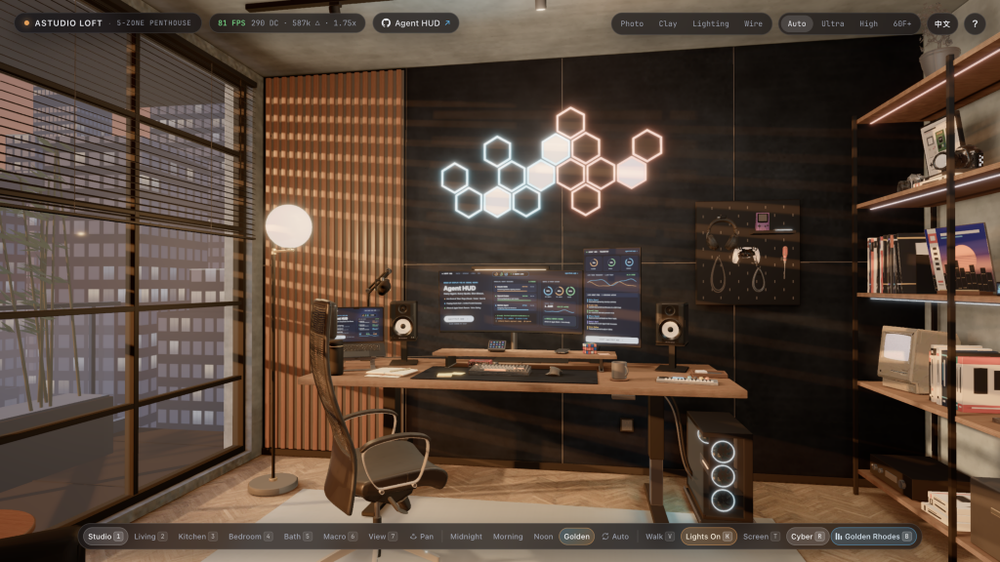
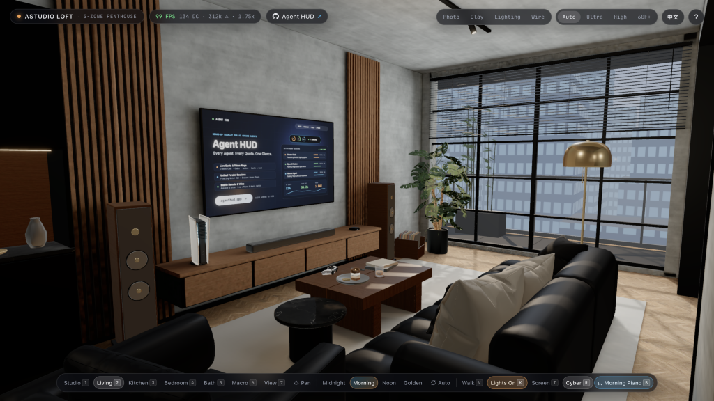
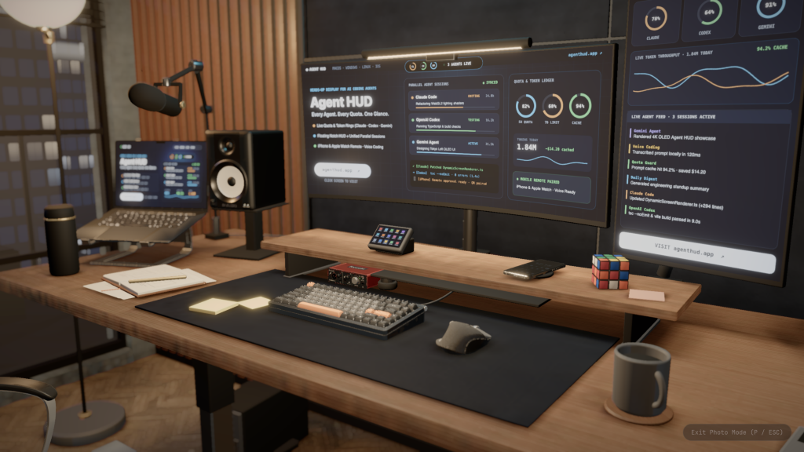

# AStudio · Personal 3D Virtual Talking-Head Studio

<p align="center">
  <strong>English</strong> · <a href="README.zh-CN.md">简体中文</a> · <a href="https://studio.agenthud.app">Live Demo</a> · <a href="https://github.com/jazzenchen/agent-hud-open">Agent HUD (Open Source)</a>
</p>

> **Built from scratch with Antigravity · Cross-session coordination powered by [Agent HUD](https://github.com/jazzenchen/agent-hud-open)**

A personal 3D virtual talking-head studio (5-zone Geek Industrial Loft) that I built from scratch using **Antigravity**, featuring real-time WebGL2 rendering, time-of-day lighting transitions, first-person walkthrough, and multi-angle cinematic camera presets.

* **Live Demo**: [studio.agenthud.app](https://studio.agenthud.app)
* **Open-Source Companion Tool I Heavily Used**: [Agent HUD (`agent-hud-open`)](https://github.com/jazzenchen/agent-hud-open) · [agenthud.app](https://agenthud.app)


---

## Features & Modes

* **Time-of-Day Switching (4 Moods)**: Switch between **Midnight / Morning / Noon / Golden Hour** or enable auto-cycling (`M`), seamlessly transitioning baked global illumination, city skyline, and sun-blind light shafts.
* **Scene & Camera Switching (7 Presets)**: Fly smoothly across **Studio, Living Room, Coffee Kitchen, Bedroom, Spa Bath, Desk Macro (shallow DoF), and Window View** via keys `1`–`7`, plus an automatic `Pan` arc sweep.
* **First-Person Walkthrough**: Press `V` to enter first-person walk mode (`WASD` + `Shift` sprint + mouse look) with collision detection.
* **Render Inspection Modes**: Toggle **Photo Mode** (hide HUD, `P`), **Clay** (`C`), **Lighting-Only** (`L`), and **Wireframe** (`G`) from the top bar.
* **Background Music & Reactive Lighting**: Toggle mood-matched soundtracks (`B`), cycle 6 audio-reactive neon modes (`R`), switch indoor lighting scenes (`K`), and cycle multi-monitor displays (`T`).
* **Performance & Quality Controls (Desktop & Mobile Tuned)**: Expandable real-time FPS / Draw Calls / triangle counter on the top left, with **Auto / Ultra / High / 60F+** quality presets—running smoothly at 60–100 FPS on desktop and specially tuned for mobile browsers as well.

---

## Screenshots

| Golden Hour · Lightmap Cross-Fade | Living Room · Morning Daylight |
| :---: | :---: |
|  |  |



---

## Building from Scratch with Antigravity & Agent HUD

Everything in this repository—the Blender Python scene pipeline, Cycles lightmap baking scripts, and Three.js interactive frontend—was built from scratch with **Antigravity**:

1. **Asset & Scene Pipeline**: Set up automated Poly Haven / BlenderKit fetching and the Blender Python scene builder.
2. **Full Loft & Lightmap Baking**: Expanded from the main desk to a 5-zone loft and baked 4 time-of-day global illumination maps.
3. **Interactive Frontend**: Built camera presets, first-person walkthrough, smooth mood transitions, reactive neon + audio, and the glassmorphic HUD.
4. **Visual QC & Polish**: Iterated via automated screenshots to fix clipping, exposure, and desktop/mobile frame pacing until ready for daily virtual studio use.

Throughout development, I ran multiple parallel Antigravity sessions (3D pipeline, frontend rendering, visual QC). **Because Antigravity has no built-in cross-session communication**, I relied heavily on my own open-source project **[Agent HUD](https://github.com/jazzenchen/agent-hud-open)** to bridge them:

* **Cross-Session Messaging**: Used Agent HUD to send messages, sync progress, and hand off tasks directly across separate Antigravity sessions.
* **Always-On Desktop HUD**: Monitored all active agent sessions, token usage, and quotas at the edge of my screen without constant window switching.

If you use Antigravity, Claude Code, Codex, or other coding agents daily, check out my open-source project **Agent HUD**:

👉 **[https://github.com/jazzenchen/agent-hud-open](https://github.com/jazzenchen/agent-hud-open)**

---

## Project Structure

```text
├── src/
│   ├── core/          # Render loop, mood/lightmap system, probes, audio, neon, dynamic screens
│   ├── interaction/   # Orbit & first-person camera controller, collisions, interactables
│   ├── ui/            # HUD controller & EN/ZH i18n
│   └── styles/        # HUD styles
├── pipeline/          # Blender Python scene builder, asset fetchers, Cycles baking & QC
├── scripts/           # Headless one-shot video recorder
├── public/            # Draco decoder, colliders, baked lightmaps, HDRIs & sky textures
└── docs/screenshots/  # Showcase screenshots
```

---

## Local Setup & Asset Notice

> **3D Asset Licensing Notice**
> The source code is licensed under **MIT**. Because the full scene uses third-party 3D models (e.g., BlenderKit Royalty-Free / official showcase models) whose licenses restrict redistribution, **merged `public/assets/full_loft.glb` and `assets/blend/full_loft.blend` are excluded from this repository**.
> * To experience the full studio immediately, visit the live demo: **[studio.agenthud.app](https://studio.agenthud.app)**.
> * To rebuild locally, fetch the assets and run the Blender pipeline below (requires Blender 4.3+):

```bash
# 1. Install dependencies
pnpm install

# 2. Fetch assets and build/bake the scene
pnpm run assets:fetch:polyhaven
pnpm run assets:fetch:blenderkit
pnpm run pipeline:loft
pnpm run pipeline:loft:bake

# 3. Start local dev server
pnpm dev
```

*(On macOS, set `BLENDER_BIN=/Applications/Blender.app/Contents/MacOS/Blender` when running pipeline scripts.)*

---

## License

Source code is licensed under the [MIT License](LICENSE). Third-party 3D models, textures, and HDRIs remain under their respective original licenses.
