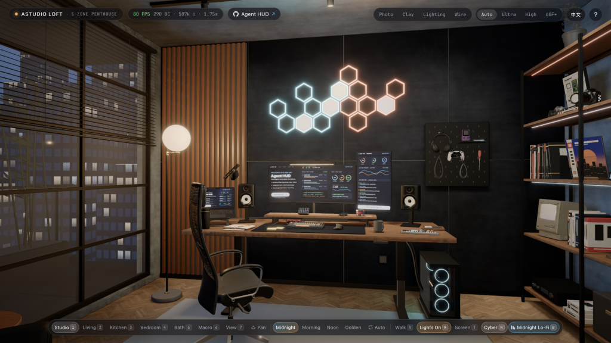

# AStudio · Virtual Studio

<p align="center">
  <strong>English</strong> · <a href="README.zh-CN.md">简体中文</a> · <a href="https://studio.agenthud.app">Live Demo</a> · <a href="https://github.com/jazzenchen/agent-hud-open">Agent HUD (Open Source)</a>
</p>

> A virtual studio for product films, built from zero with Antigravity + three.js. Rendered live in the browser — walk it at [studio.agenthud.app](https://studio.agenthud.app).

Built from scratch with **Antigravity** and coordinated across sessions via **[Agent HUD](https://github.com/jazzenchen/agent-hud-open)**, this 5-zone Geek Industrial Loft features real-time WebGL2 rendering, time-of-day lighting transitions, first-person walkthrough, and multi-angle cinematic camera presets.

* **Live Demo**: [studio.agenthud.app](https://studio.agenthud.app)
* **Open-Source Companion Tool I Heavily Used**: [Agent HUD (`agent-hud-open`)](https://github.com/jazzenchen/agent-hud-open) · [agenthud.app](https://agenthud.app)



---

## Features & Modes

* **Time-of-Day Switching (4 Moods)**: Switch between **Midnight / Morning / Noon / Golden Hour** or enable auto-cycling (`M`), seamlessly transitioning baked global illumination, city skyline, and sun-blind light shafts.
* **Scene & Camera Switching (7 Presets)**: Fly smoothly across **Studio, Living Room, Coffee Kitchen, Bedroom, Spa Bath, Desk Macro (shallow DoF), and Window View** via keys `1`–`7`, plus an automatic `Pan` arc sweep.
* **First-Person Walkthrough**: Press `V` to enter first-person walk mode (`WASD` + `Shift` sprint + mouse look) with collision detection.
* **Render Inspection Modes**: Toggle **Photo Mode** (hide HUD, `P`), **Clay** (`C`), **Lighting-Only** (`L`), and **Wireframe** (`G`) from the top bar.
* **Background Music & Reactive Lighting**: Toggle mood-matched soundtracks (`B`, generated in Antigravity along with the 3 skyline backdrops), cycle 6 audio-reactive neon modes (`R`), switch indoor lighting scenes (`K`), and cycle multi-monitor displays (`T`).
* **Performance & Quality Controls (Desktop & Mobile Tuned)**: Expandable real-time FPS / Draw Calls / triangle counter on the top left, with **Auto / Ultra / High / 60F+** quality presets—running smoothly at 60–100 FPS on desktop and specially tuned for mobile browsers as well.

---

## Screenshots

| Golden Hour · Lightmap Cross-Fade | Living Room · Morning Daylight |
| :---: | :---: |
|  |  |


---

## Building from Scratch with Antigravity & Agent HUD

Everything in this repository—the Blender Python scene pipeline, Cycles lightmap baking scripts, and Three.js interactive frontend—was built from scratch with **Antigravity**:

1. **Asset & Scene Pipeline**: Set up automated Poly Haven / BlenderKit fetching and the Blender Python scene builder.
2. **Full Loft & Lightmap Baking**: Expanded from the main desk to a 5-zone loft and baked 4 time-of-day global illumination maps.
3. **Interactive Frontend**: Built camera presets, first-person walkthrough, smooth mood transitions, reactive neon + audio, and the glassmorphic HUD.
4. **Visual QC & Polish**: Iterated via automated screenshots to fix clipping, exposure, and desktop/mobile frame pacing until ready for filming product videos.

Throughout development, I ran multiple parallel Antigravity sessions (3D pipeline, frontend rendering, visual QC). **Because Antigravity has no built-in cross-session communication**, I relied heavily on my own open-source project **[Agent HUD](https://github.com/jazzenchen/agent-hud-open)** to bridge them:

* **Cross-Session Messaging**: Used Agent HUD to send messages, sync progress, and hand off tasks directly across separate Antigravity sessions.
* **Always-On Desktop HUD**: Monitored all active agent sessions, token usage, and quotas at the edge of my screen without constant window switching.

If you use Antigravity, Claude Code, Codex, or other coding agents daily, check out my open-source project **Agent HUD**:

👉 **[https://github.com/jazzenchen/agent-hud-open](https://github.com/jazzenchen/agent-hud-open)**

---

## Project Structure

```text
├── src/
│   ├── core/          # Render loop, mood/lightmap system, probes, audio, neon, dynamic screens
│   ├── interaction/   # Orbit & first-person camera controller, collisions, interactables
│   ├── ui/            # HUD controller & EN/ZH i18n
│   └── styles/        # HUD styles
├── pipeline/          # Blender Python scene builder, asset fetchers, Cycles baking & QC
├── scripts/           # Headless one-shot video recorder
├── public/            # Draco decoder, colliders, baked lightmaps, HDRIs & sky textures
└── docs/screenshots/  # Showcase screenshots
```

---

## Third-Party Assets & Local Rebuild

### Why `full_loft.glb` and `full_loft.blend` Are Not in This Repository

The merged scene files (`public/assets/full_loft.glb` and `assets/blend/full_loft.blend`) combine 3D models whose licenses forbid redistribution. A fresh clone therefore runs without the full merged scene—visit the live demo at **[studio.agenthud.app](https://studio.agenthud.app)** to explore the complete studio right away.

### Asset Breakdown (Full Attribution Table)

See **[`docs/THIRD_PARTY_ASSETS.md`](docs/THIRD_PARTY_ASSETS.md)** for the complete item-by-item table with authors and direct links:

* **57 BlenderKit Royalty-Free (RF) models** *(not in repo)* — BlenderKit's Royalty-Free license allows use in a rendered work or hosted experience, but forbids redistributing the 3D files themselves.
* **2 BlenderKit CC0 models** *(CC0, fetched locally)* — `screwdriver_real` and `zaku_gunpla`.
* **3 Apple AR Quick Look `.usdz` models** *(not in repo)* — Mac mini, Mac Studio, and MacBook Air 15" Midnight from Apple's official product pages; these belong to Apple Inc. and are not redistributable (`build_studio_slice.py` skips them cleanly if absent).
* **Poly Haven CC0 assets** — 3 HDRIs are already committed under `public/assets/hdris/`; 16 CC0 3D models and 12 CC0 PBR textures are fetched locally via `pipeline/fetch_polyhaven.py`.
* **Original / Generated Media (included in repo)** — The 4 ambient MP3 soundtracks (`public/assets/audio/*.mp3`) and 3 city skyline backdrops (`public/assets/sky/*.jpg`) were generated in Antigravity and are included directly in this repository.

### Rebuilding the Full Scene Locally

Requires **Blender 4.3+**, **Python 3**, and **pnpm**:

```bash
# 1. Install frontend dependencies
pnpm install

# 2. Fetch Poly Haven CC0 textures, HDRIs, and 3D models (no account required)
python3 pipeline/fetch_polyhaven.py --phase all

# 3. Fetch BlenderKit models into assets/cache/blenderkit/
#    (A BlenderKit account is needed for Royalty-Free assets if downloading manually / via the BlenderKit add-on)
python3 pipeline/fetch_blenderkit.py --phase all

# 4. Assemble the full 5-zone loft -> outputs assets/blend/full_loft.blend
${BLENDER_BIN:-blender} -b --factory-startup --python pipeline/build_full_loft.py

# 5. Bake Cycles HDR RGBM lightmaps & export glTF -> outputs:
#    - public/assets/full_loft.glb
#    - public/assets/lightmaps/loft_{east,west}_{midnight,daylight,noon,golden}.png
#    - public/assets/loft_colliders.json
${BLENDER_BIN:-blender} -b --factory-startup --python pipeline/bake_full_loft.py

# 6. Start local dev server
pnpm dev
```

*(On macOS, set `BLENDER_BIN=/Applications/Blender.app/Contents/MacOS/Blender` when running pipeline scripts.)*

---

## License

Source code is licensed under the [MIT License](LICENSE). Third-party 3D models, textures, and HDRIs remain under their respective original licenses.
