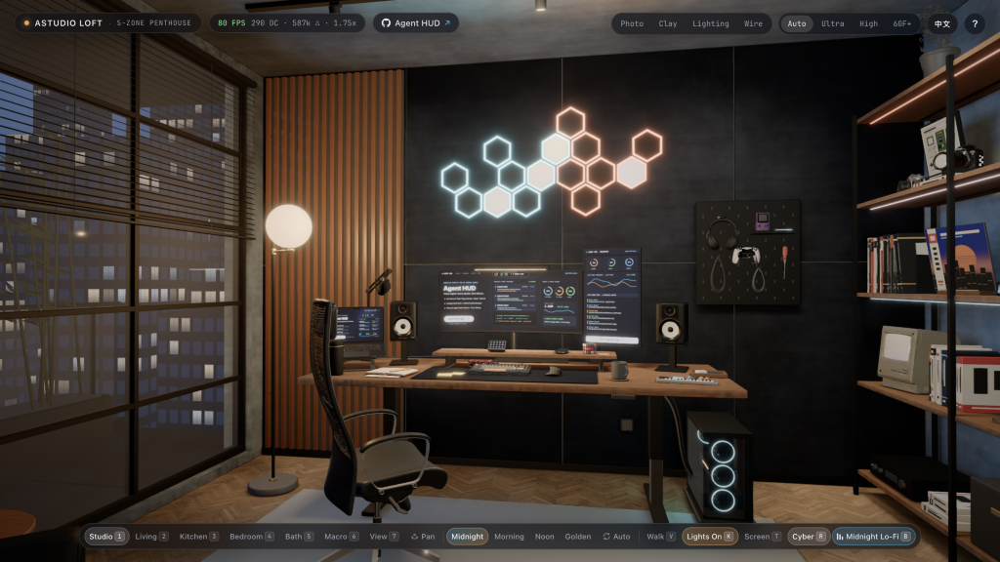
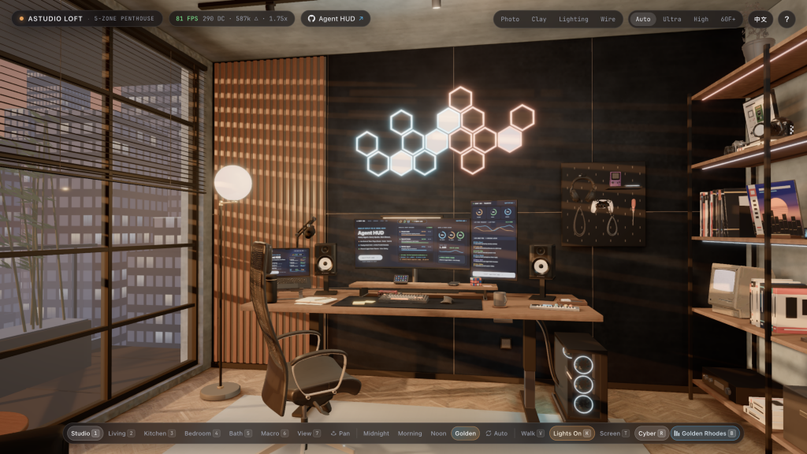
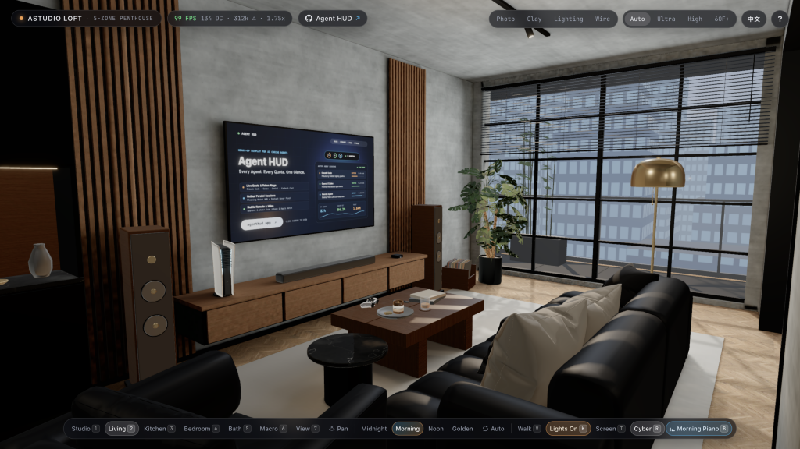
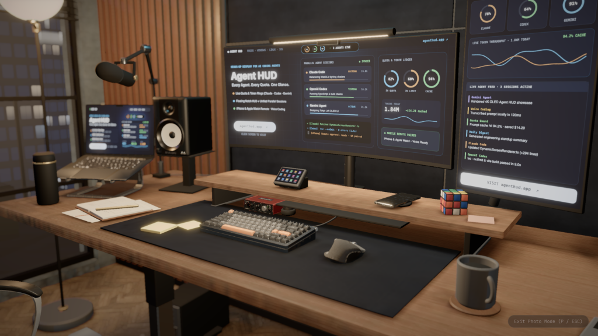

# AStudio · 个人 3D 虚拟口播 Studio

<p align="center">
  <a href="README.md">English</a> · <strong>简体中文</strong> · <a href="https://studio.agenthud.app">在线体验</a> · <a href="https://github.com/jazzenchen/agent-hud-open">Agent HUD (开源项目)</a>
</p>

> **用 Antigravity 从零打造的个人 3D 虚拟口播 Studio · 通过 [Agent HUD](https://github.com/jazzenchen/agent-hud-open) 辅助跨 Session 通信**

这是一个我用 **Antigravity** 从零搭建的个人虚拟口播 Studio（5 区域极客工业风 Loft），支持浏览器端实时交互、多时段光照切换、第一人称漫游与多机位拍摄。

* **在线体验**：[studio.agenthud.app](https://studio.agenthud.app)
* **搭建期间重度使用的开源工具**：[Agent HUD (`agent-hud-open`)](https://github.com/jazzenchen/agent-hud-open) · [agenthud.app](https://agenthud.app)



---

## 功能与玩法

* **切换时间（4 种昼夜氛围）**：支持 **Midnight（深夜）/ Morning（清晨）/ Noon（正午）/ Golden（黄金时刻）** 一键切换或自动轮播（快捷键 `M`），同步切换烘焙全局光照、窗外城市天际线与百叶窗日光角度。
* **切换场景（7 个电影机位）**：覆盖 **Studio 工作室、Living 客厅、Kitchen 咖啡厨房、Bedroom 卧室、Bath 浴室、Macro 桌面微距（自动浅景深）、View 落地窗露台**，数字键 `1`–`7` 一键平滑飞镜，支持 `Pan` 自动弧线巡航。
* **自由漫游（第一人称 Walk 模式）**：按 `V` 随时切入第一人称视角，支持 `WASD` 移动、`Shift` 加速、鼠标环视与防穿模碰撞检测。
* **多种检视模式**：顶部一键切换 **Photo（纯净摄影隐藏 HUD，`P`）**、**Clay（纯白模，`C`）**、**Lighting（纯光照检视，`L`）**、**Wire（线框拓扑，`G`）**。
* **背景音乐与氛围联动**：按 `B` 开关随时间段切换的背景配乐（4 首配乐与 3 张城市天际线背景图均由 Antigravity 生成并已包含在仓库中）；按 `R` 切换 6 种霓虹灯效并随音乐节奏实时律动；按 `K` 切换全屋照明情景，按 `T` 切换桌面多屏画面。
* **性能与画质调控（已做桌面 & 手机端专项调优）**：左上角可展开实时 FPS / Draw Calls / 三角面数监控，右上角支持 **Auto / Ultra / High / 60F+** 四档画质切换；桌面端可稳定运行在 60–100 FPS，同时也针对手机端性能做了专门调优，手机浏览器打开同样流畅。

---

## 实机截图

| Golden Hour · 黄金时刻光影 | Living Room · 清晨客厅机位 |
| :---: | :---: |
|  |  |



---

## Antigravity 从零搭建过程 & 为什么重度使用 Agent HUD

整个项目的 Blender 自动化建景、Cycles 光照烘焙管线、Three.js 前端渲染与交互逻辑，全部是我用 **Antigravity** 从零一步步搭建出来的：

1. **搭管线**：先让 Antigravity 写好 Poly Haven / BlenderKit 资产拉取脚本和 Blender Python 建景框架。
2. **扩空间与烘焙**：从口播主桌扩展到全屋 5 个功能区，自动化烘焙 4 个时间段的全局光照贴图。
3. **写前端与调交互**：实现多机位、第一人称漫游、四时段平滑切换、音频律动和玻璃拟态 HUD。
4. **实机 QC 与打磨**：反复截图检视穿模、曝光和桌面/手机端帧率，逐项调优到可作为日常虚拟口播场景使用。

搭建过程中我经常同时开多个 Antigravity Session 并行推进（建景烘焙、前端交互、实机截图排查）。**因为 Antigravity 本身没有 Session 间通信能力**，多会话之间没法直接同步状态或交接结果，所以我全程重度使用自己开源的 **[Agent HUD](https://github.com/jazzenchen/agent-hud-open)** 来辅助：

* **Session 间通信**：用 Agent HUD 桥接多个 Antigravity 会话，直接跨 Session 发消息、同步进度与交接任务。
* **桌面常驻监控**：在屏幕边缘实时盯住所有并行 Agent 的会话状态、Token 与配额，不用反复切窗口。

如果你也在高频使用 Antigravity、Claude Code、Codex 等 AI Agent，推荐看看我的开源项目 **Agent HUD**：

👉 **[https://github.com/jazzenchen/agent-hud-open](https://github.com/jazzenchen/agent-hud-open)**

---

## 项目结构

```text
├── src/
│   ├── core/          # 渲染主循环、光照切换、反射探针、音频引擎、霓虹灯效与动态屏幕
│   ├── interaction/   # 轨道/第一人称双模式相机、碰撞检测、交互物体
│   ├── ui/            # HUD 控制栏与中英双语 i18n
│   └── styles/        # HUD 样式
├── pipeline/          # Blender Python 自动化建景、资产拉取、Cycles 烘焙与 QC 脚本
├── scripts/           # 一镜到底视频录制脚本
├── public/            # Draco 解码器、碰撞数据、光贴图、HDRI 与天空球
└── docs/screenshots/  # 实机截图
```

---

## 第三方素材与本地重建

### 为什么仓库中不包含 `full_loft.glb` 和 `full_loft.blend`

合并后的场景文件（`public/assets/full_loft.glb` 和 `assets/blend/full_loft.blend`）包含了协议禁止再分发的第三方 3D 模型。因此直接克隆本仓库运行不会包含完整合并场景；想直接体验完整成品，请访问在线 Demo：**[studio.agenthud.app](https://studio.agenthud.app)**。

### 素材清单与协议说明

完整的逐项列表（含作者、协议与直达链接）见 **[`docs/THIRD_PARTY_ASSETS.md`](docs/THIRD_PARTY_ASSETS.md)**：

* **57 个 BlenderKit Royalty-Free 模型**（未入库）：BlenderKit 的 Royalty-Free 协议允许在渲染作品或在线展示中使用，但**禁止再分发 3D 模型文件本身**。
* **2 个 BlenderKit CC0 模型**（CC0，本地脚本拉取）：`screwdriver_real` 与 `zaku_gunpla`。
* **3 个 Apple AR Quick Look `.usdz` 模型**（未入库）：Mac mini、Mac Studio 与 MacBook Air 15 英寸午夜色，来自苹果官方产品页，归 Apple Inc. 所有且不可再分发（本地缺失时 `build_studio_slice.py` 会自动跳过，不影响构建）。
* **Poly Haven CC0 资产**：3 张 2K HDRI 已直接提交在 `public/assets/hdris/`；16 个 CC0 3D 模型与 12 套 CC0 PBR 贴图可通过 `pipeline/fetch_polyhaven.py` 本地拉取。
* **原创 / 生成媒体（已包含在仓库中）**：4 首环境配乐（`public/assets/audio/*.mp3`）与 3 张城市天际线背景图（`public/assets/sky/*.jpg`）均在 Antigravity 中生成，已直接随仓库发布。

### 本地重建完整场景

需本机安装 **Blender 4.3+**、**Python 3** 和 **pnpm**：

```bash
# 1. 安装前端依赖
pnpm install

# 2. 拉取 Poly Haven CC0 贴图、HDRI 与 3D 模型（无需账号）
python3 pipeline/fetch_polyhaven.py --phase all

# 3. 拉取 BlenderKit 模型至 assets/cache/blenderkit/
#    （手动下载或通过 BlenderKit 插件获取 Royalty-Free 模型需 BlenderKit 账号）
python3 pipeline/fetch_blenderkit.py --phase all

# 4. 组装全屋 5 区域场景 -> 输出 assets/blend/full_loft.blend
${BLENDER_BIN:-blender} -b --factory-startup --python pipeline/build_full_loft.py

# 5. 烘焙 Cycles HDR RGBM 光贴图并导出 glTF -> 输出：
#    - public/assets/full_loft.glb
#    - public/assets/lightmaps/loft_{east,west}_{midnight,daylight,noon,golden}.png
#    - public/assets/loft_colliders.json
${BLENDER_BIN:-blender} -b --factory-startup --python pipeline/bake_full_loft.py

# 6. 启动本地开发服务
pnpm dev
```

*(macOS 运行 Blender 命令时可指定 `BLENDER_BIN=/Applications/Blender.app/Contents/MacOS/Blender`)*

---

## License

源代码基于 [MIT License](LICENSE) 开源。第三方 3D 模型、贴图与 HDRI 资产遵循各自原始协议。
